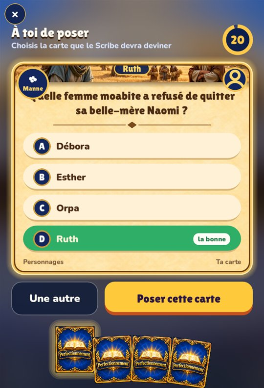
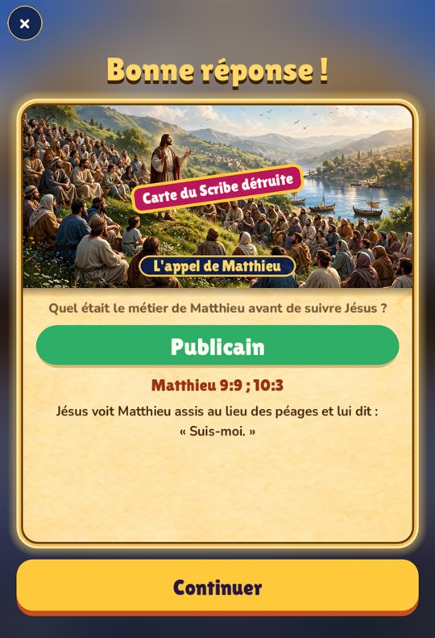
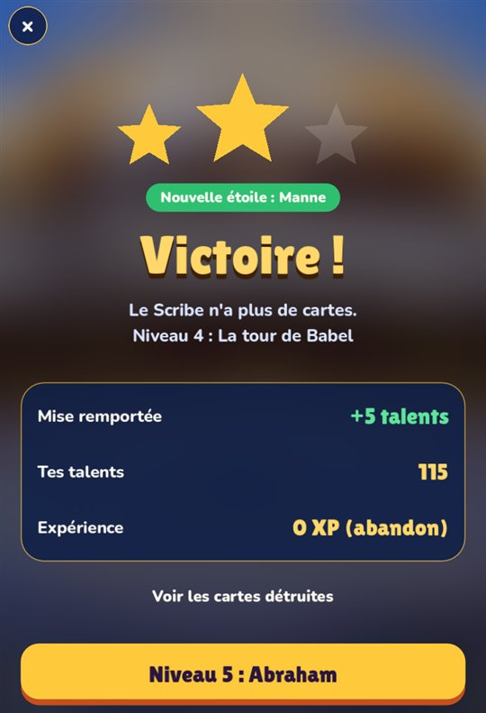
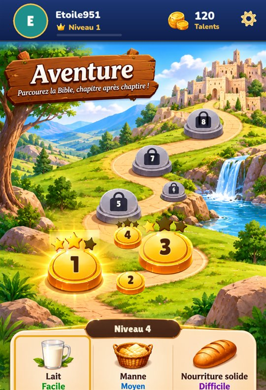
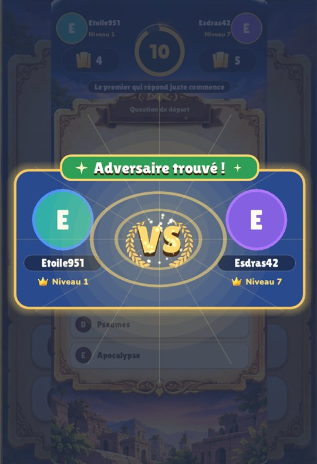
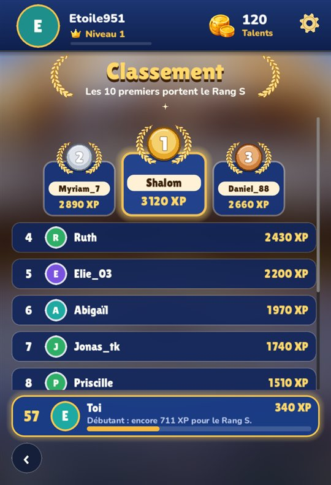

  

  <b>Le jeu de cartes qui fait grandir dans la connaissance de la Bible.</b> 
  Pose tes questions, devine celles de ton adversaire, et sois le dernier à garder des cartes en main.

  
  

---

## Le jeu

Chaque joueur reçoit **5 cartes**. Chaque carte porte une question sur la Bible, sa bonne réponse,
la référence du passage (Louis Segond 1910) et une illustration peinte de son livre.

1. **Question de départ** : une question est posée aux deux joueurs en même temps. Le premier qui
   répond juste commence.
2. **À tour de rôle, on pose une carte** à l'adversaire, qui choisit parmi les réponses proposées.
3. **Il trouve ?** Ta carte brûle au feu doré, et chacun découvre le passage et son explication.
4. **Il se trompe ?** La carte te revient, sans révéler la réponse, avec une proposition de moins.
   Bonne mémoire exigée : une fausse réponse peut être remplacée par une autre jamais vue.
5. **Le premier joueur qui n'a plus de cartes perd.**

Trois niveaux de difficulté : **Lait** (facile), **Manne** (moyen) et **Nourriture solide**
(difficile), d'après Hébreux 5:12-14.

  
  
  
  

## Les modes de jeu

| | |
|---|---|
| **Aventure** | Affronte le Scribe niveau après niveau, chapitre après chapitre. Chaque difficulté gagnée rapporte une étoile. |
| **En ligne** | Duel rapide contre un joueur au hasard, ou partie entre amis avec un code à partager. |
| **Jouer à deux** | Sur un seul téléphone, que vous vous passez à chaque question. Sans compte. |

  
  
  
  

## Progresser

- **Talents** : la monnaie du jeu. On les mise en duel et contre le Scribe, et 10 arrivent chaque
  jour avec le **pain quotidien**.
- **XP et niveaux** : chaque partie rapporte de l'expérience, de Débutant à Maître biblique.
- **Classement général** : les 10 premiers portent le **Rang S**.
- **Compte** : joue tout de suite en invité, puis crée un compte (e-mail ou Google) pour retrouver
  ta progression sur un autre téléphone.

## Installer

1. Sur ton téléphone Android, ouvre le lien
   **[Télécharger Perfectionnement](https://github.com/juniorbrindou/perfectionnement-releases/releases/latest/download/perfectionnement.apk)**.
2. Ouvre le fichier téléchargé. La première fois, Android demande d'autoriser l'installation
   depuis ton navigateur : accepte.
3. Lance le jeu. Une connexion Internet est nécessaire pour l'aventure, les duels en ligne et le
   classement ; le jeu à deux fonctionne sans.

## Mises à jour

Le jeu te prévient lui-même quand une nouvelle version est disponible : touche **Télécharger**,
puis installe-la par-dessus. Ta progression est gardée.

Toutes les versions et leurs nouveautés : **[Versions](https://github.com/juniorbrindou/perfectionnement-releases/releases)**.

---

Version de test avant la sortie sur Google Play. Android uniquement. · <a href="CONFIDENTIALITE.md">Règles de confidentialité</a>

